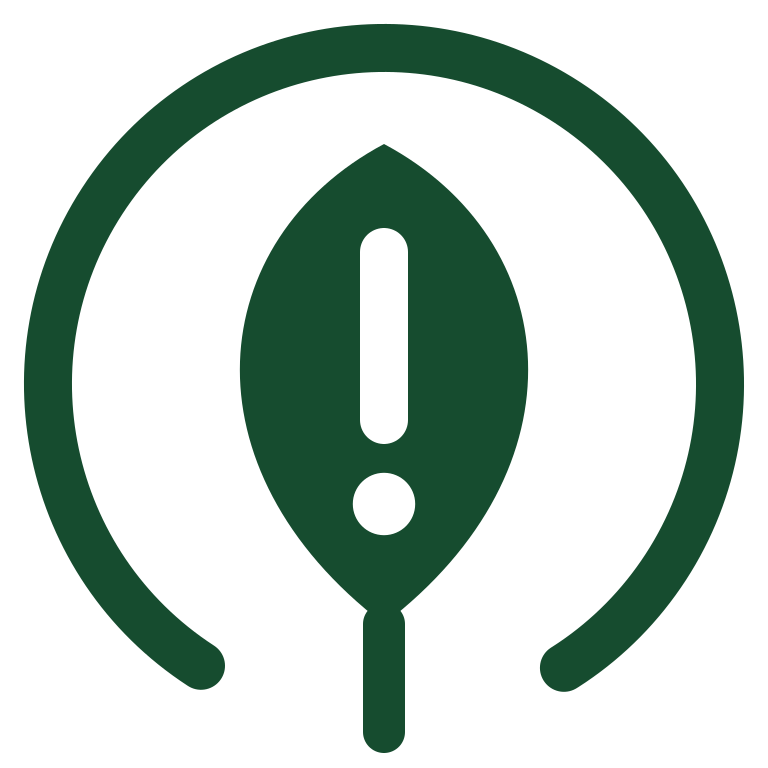
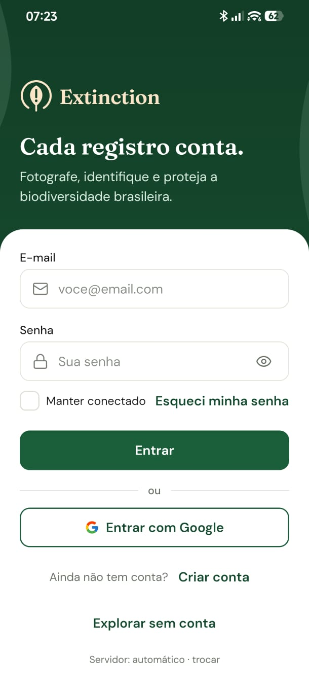
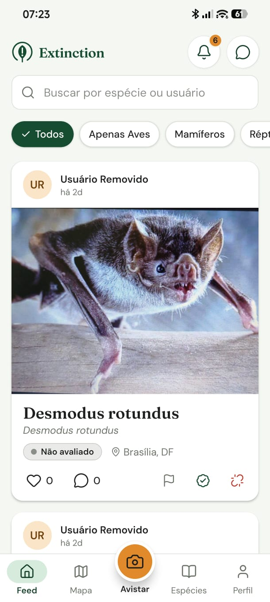
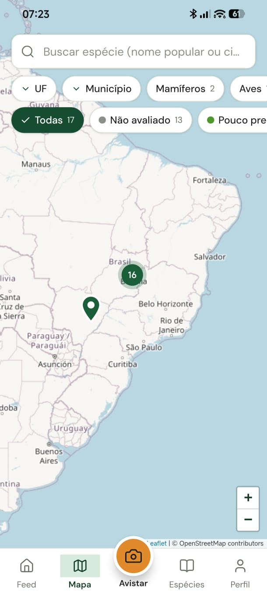
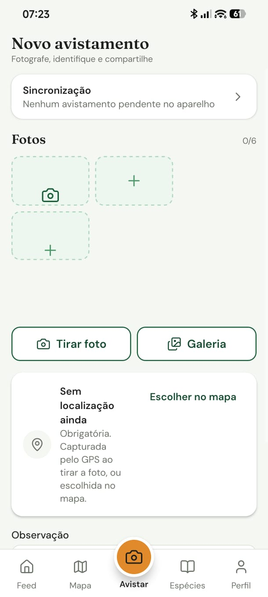
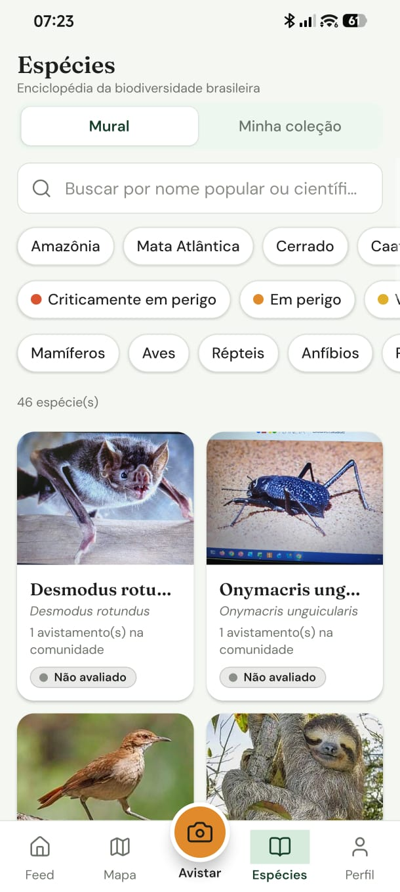
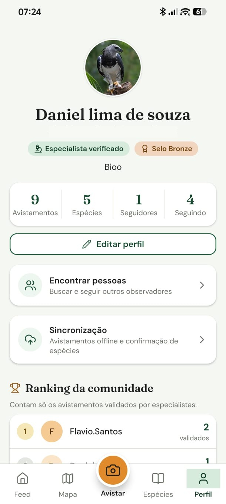
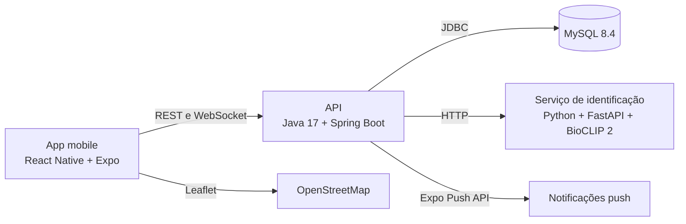

  

<h1 align="center">Extinction</h1>

  App de ciência cidadã que transforma fotos de campo em dados georreferenciados sobre a biodiversidade brasileira.

  Projeto acadêmico · Engenharia de Software · Universidade Católica de Brasília · Grupo 11 · 2026

<table>
  <tr>
    <td align="center"> Login</td>
    <td align="center"> Feed</td>
    <td align="center"> Mapa</td>
  </tr>
  <tr>
    <td align="center"> Novo avistamento</td>
    <td align="center"> Espécies</td>
    <td align="center"> Perfil</td>
  </tr>
</table>

Capturas do app em execução. O protótipo está em <a href="docs/design.md">Design</a>.

## O problema

O Brasil concentra uma parte enorme da biodiversidade conhecida, mas faltam dados atualizados sobre onde as espécies ameaçadas ainda estão. Plataformas internacionais de identificação têm cobertura menor de espécies locais e pouca informação sobre o status de conservação delas.

O Extinction aposta em um formato social e simples: quem está em uma trilha fotografa um animal ou uma planta, confirma a espécie sugerida pela IA e publica o registro. Cada publicação vira um ponto no mapa e um dado que especialistas podem validar.

## Como funciona

1. **Foto:** o usuário envia de 1 a 6 imagens JPG ou PNG.
2. **Identificação:** o BioCLIP 2 sugere até 5 espécies com confiança mínima de 20%.
3. **Confirmação:** o usuário confirma a espécie correta.
4. **Localização:** o app registra latitude, longitude, data e hora, aceitando apenas coordenadas do território brasileiro.
5. **Selo de conservação:** o sistema aplica o status IUCN/MMA da espécie.
6. **Publicação:** o avistamento entra no feed e no mapa.

Sem sinal, o registro fica em uma fila no aparelho e percorre o mesmo caminho quando a conexão volta.

## Principais funcionalidades

- **Conta:** cadastro, login com JWT, recuperação de senha por código e modo de visitante.
- **Avistamentos:** várias fotos por postagem, curtidas, comentários, edição e exclusão.
- **Modo offline:** fila de até 100 registros, com envio automático e sem duplicatas.
- **Mapa:** agrupamento de marcadores, busca e filtros por status, categoria, UF e município.
- **Enciclopédia:** mural de espécies, ficha técnica, coleção pessoal e selos de raridade.
- **Curadoria científica:** a comunidade contesta identificações, e especialistas validam ou desvinculam espécies.
- **Comunidade:** seguidores, ranking com avistamentos validados, chat direto e em grupo e notificações.
- **Administração:** painel web para selos de especialista e dados das espécies.

## Arquitetura

| Camada | Tecnologias |
|---|---|
| App | React Native 0.88, Expo SDK 58, TypeScript, React Navigation, Leaflet em WebView |
| API | Java 17, Spring Boot 3.4, Spring Security, JPA/Hibernate, JWT, WebSocket, OpenAPI |
| Dados | MySQL 8.4 |
| Identificação de espécies | Python, FastAPI, BioCLIP 2 |
| Infraestrutura | Docker Compose, GitHub Actions, EAS Build |
| Testes | JUnit, Testcontainers, scripts de API em Python, JMeter, OWASP ZAP |

As decisões e os fluxos estão em [Arquitetura](docs/arquitetura.md).

## Qualidade

Resultados da execução de 22/10/2026, em ambiente local com Docker Compose e o serviço de IA em CPU.

| Verificação | Resultado |
|---|---|
| Testes do backend, incluindo integração com MySQL | 133 de 133 aprovados |
| Baterias de API e regressão dos MVPs | 185 de 185 verificações aprovadas |
| Identificação de espécie (30 fotos, meta de até 5 s) | Média de 874 ms, p95 de 972 ms |
| Carga com 100 usuários simultâneos no JMeter | 7.836 requisições, 100% de sucesso, p95 de 28 ms |
| Varredura OWASP ZAP da API | 0 alertas altos, 0 médios, 2 baixos e 3 informativos |
| Modo offline | 100 registros recuperados, sem duplicatas |

A metodologia, os defeitos encontrados e o que ainda falta validar estão em [Qualidade](docs/qualidade.md).

## Estado do projeto

Entrega final do MVP 1.0 prevista para 07/11/2026.

Ainda dependem de pessoas, aparelhos ou contas externas:

- teste de usabilidade com 10 participantes;
- paridade entre Android e iOS, que exige um build para iPhone;
- medição de consumo de bateria em aparelho real;
- credenciais de produção para login social e push remoto.

## Equipe

**Grupo 11**

- Daniel Souza de Lima, Gerente de Projeto
- [Flávio Daniel Rocha Santos](https://github.com/Fdanielsantos)
- Guilherme Alves Rocha
- Cayky Emílio Vieira Neves

### Meu papel

Atuei como Gerente de Projeto, cuidando do planejamento das entregas e da documentação. No desenvolvimento, contribuí principalmente com a API, as telas do app, as baterias de teste e os modelos de processo de negócio.

## Documentação

- [Produto e requisitos](docs/produto.md)
- [Arquitetura](docs/arquitetura.md)
- [Telas do app](docs/telas.md)
- [Design](docs/design.md)
- [Processos de negócio](docs/processos.md)
- [Qualidade](docs/qualidade.md)
- [Documento de Visão (PDF)](docs/documentos/Documento-de-Visao.pdf)
- [Documento de Requisitos (PDF)](docs/documentos/Documento-de-Requisitos.pdf)

## Código-fonte

O código é mantido em um repositório privado. Para uma avaliação técnica, fale comigo pelo [LinkedIn](https://www.linkedin.com/in/daniel-souzade-lima).
