# Arquitetura

[Voltar ao início](../README.md)

## Visão geral

O sistema tem três processos: o app mobile, a API e o serviço de identificação de espécies. O app fala apenas com a API, que orquestra o banco de dados, a IA, os arquivos e as notificações. Docker Compose sobe a API, o MySQL e o serviço de identificação juntos.

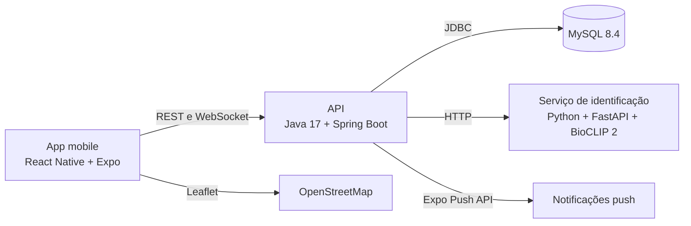

## Camadas do backend

Cada pacote Java tem uma responsabilidade definida, e toda requisição autenticada passa antes pelo filtro de segurança.

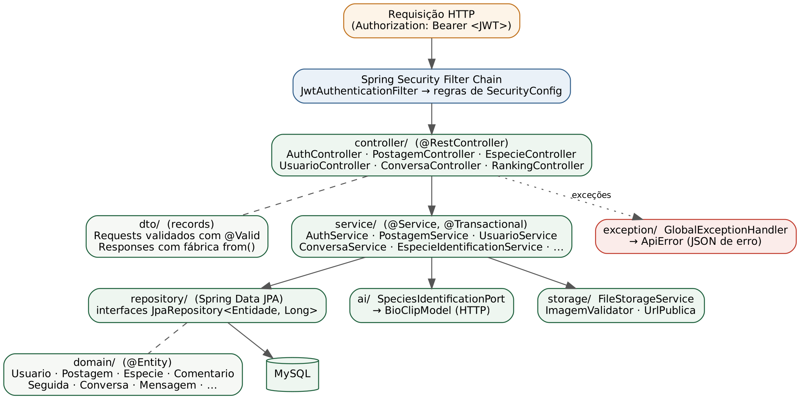

## Decisões principais

### Identificação no servidor com BioCLIP 2

A primeira abordagem foi treinar um classificador próprio em TensorFlow. Ela exigia muitas imagens rotuladas, escassas para espécies brasileiras. A equipe migrou para o BioCLIP 2, um modelo aberto e pré-treinado, executado em um serviço Python separado.

Com isso, o resultado é o mesmo em qualquer aparelho, o modelo pode ser atualizado sem publicar o app e a inferência roda em um pool assíncrono próprio, sem travar as demais requisições. A API devolve até 5 candidatas com confiança mínima de 20%, e o usuário sempre confirma a espécie.

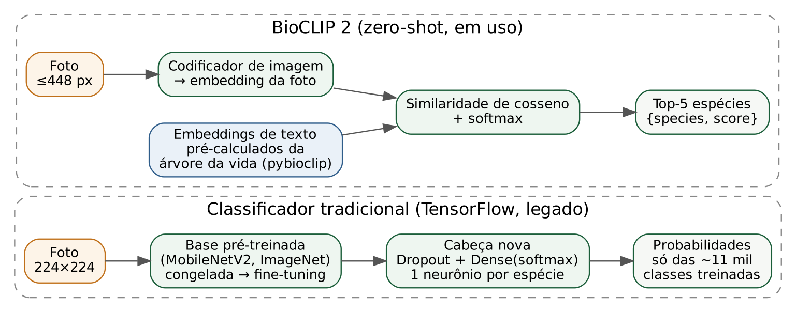

### Modo offline com padrão Outbox

Trilhas e áreas rurais costumam ter pouco sinal. O avistamento é salvo no aparelho com um UUID e enviado em ordem quando a conexão volta, com novas tentativas em caso de falha. O UUID torna o envio idempotente, então reenvios não criam duplicatas. A espécie é identificada na sincronização, e o usuário confirma antes de publicar.

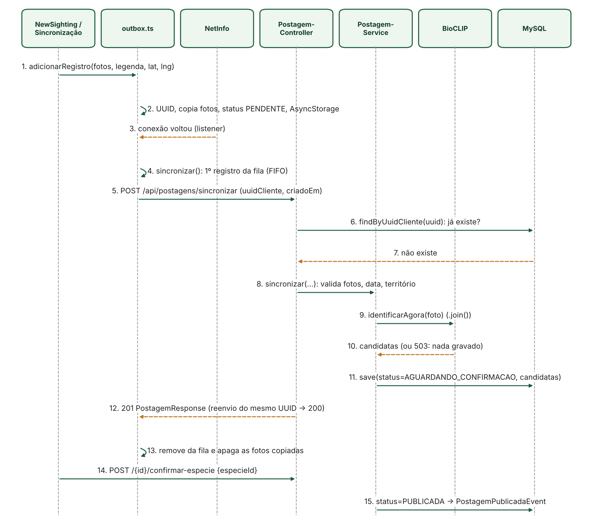

### Autenticação stateless

A API usa JWT em todas as requisições autenticadas, senhas com BCrypt e controle de acesso por perfil. O login com Google e Apple é validado no backend por OIDC, que então emite o JWT interno.

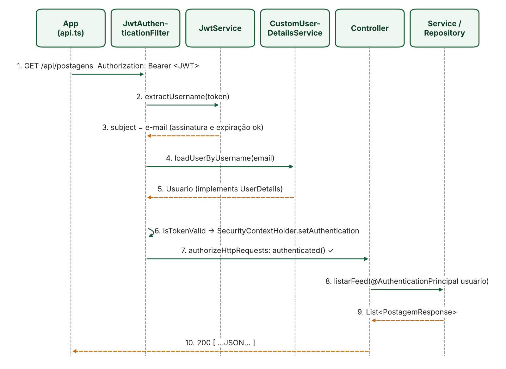

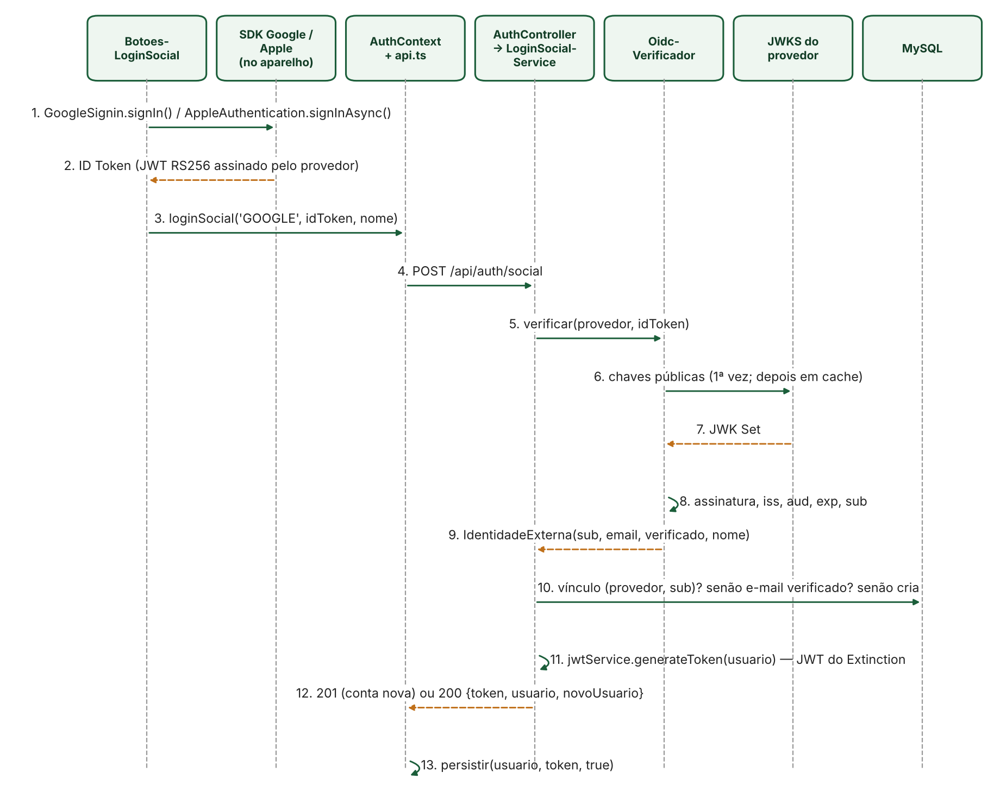

### Tempo real com WebSocket

Chat, novos avistamentos e notificações usam WebSocket. O token é validado no handshake, então uma conexão sem autenticação é recusada antes de abrir.

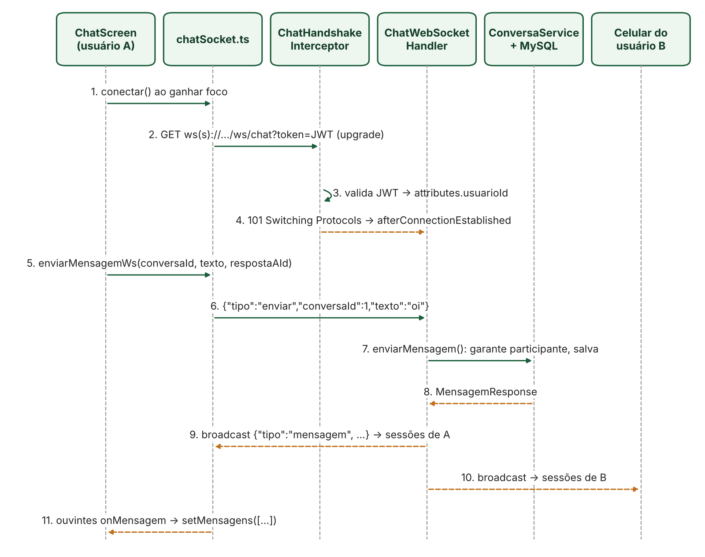

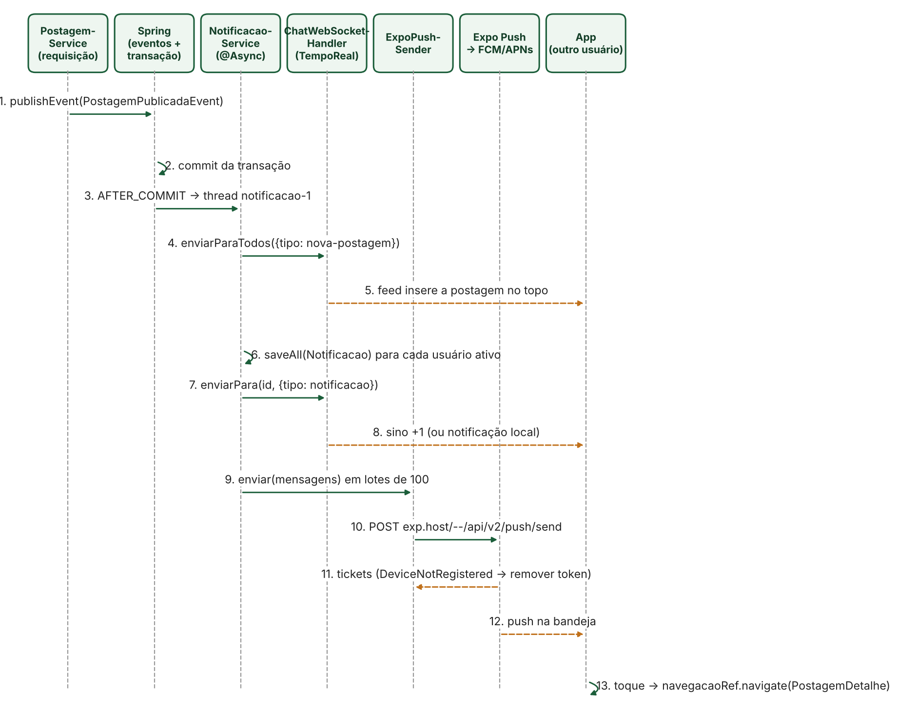

## Fluxo de publicação

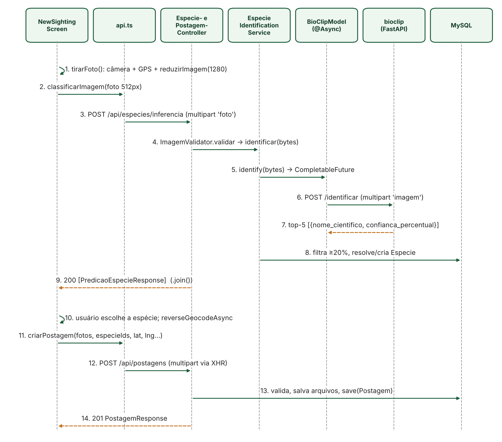

## Modelo de dados

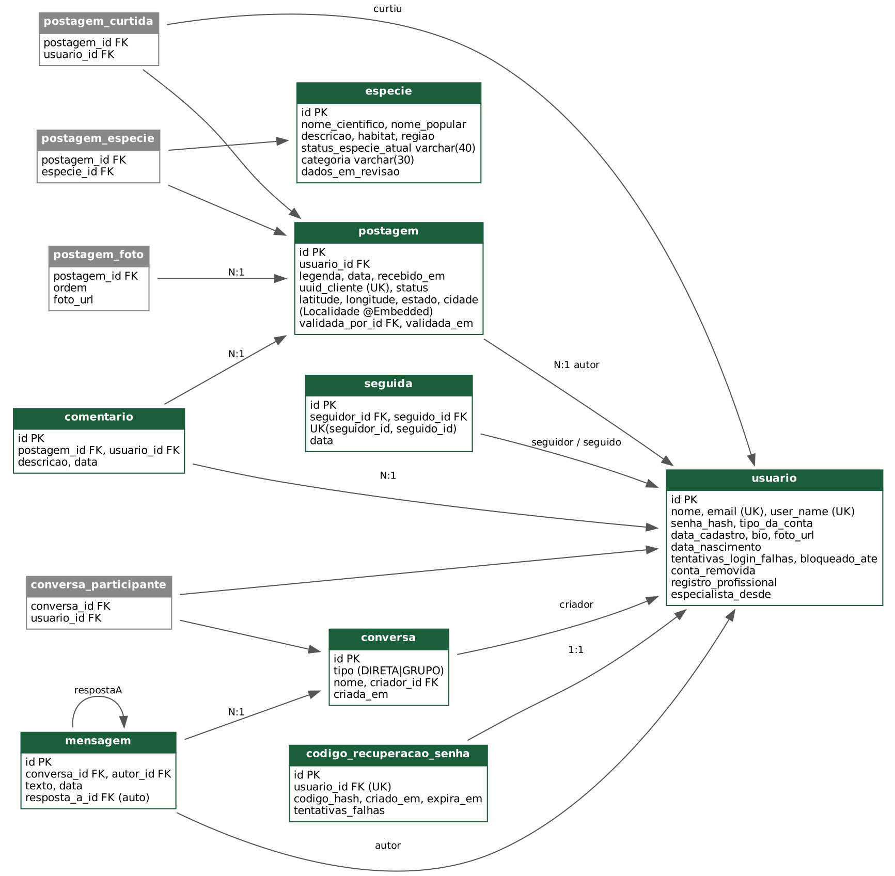

Tabelas adicionadas nos MVPs 0.2 e 1.0:

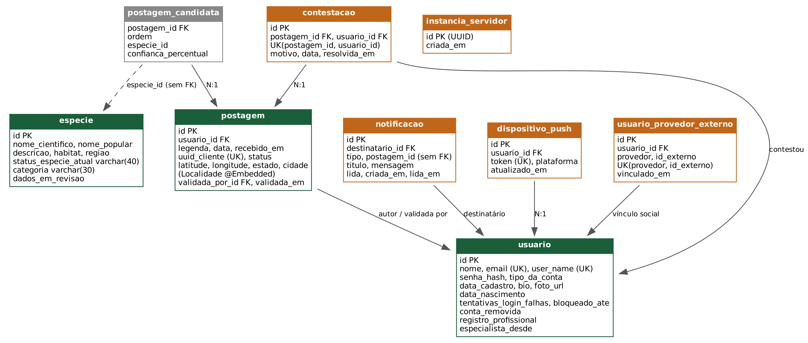

## Próximas evoluções

- Migrações versionadas de banco de dados.
- Limite de requisições nos endpoints públicos.
- Integração automática com bases oficiais de status de conservação.
