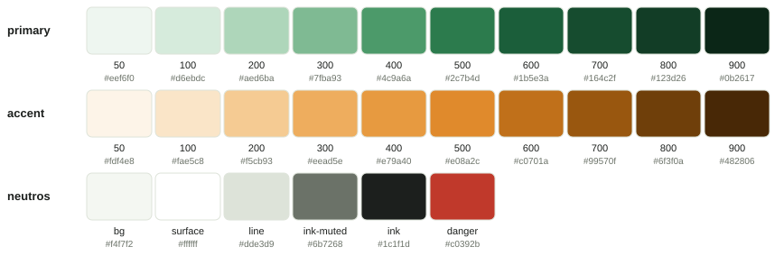
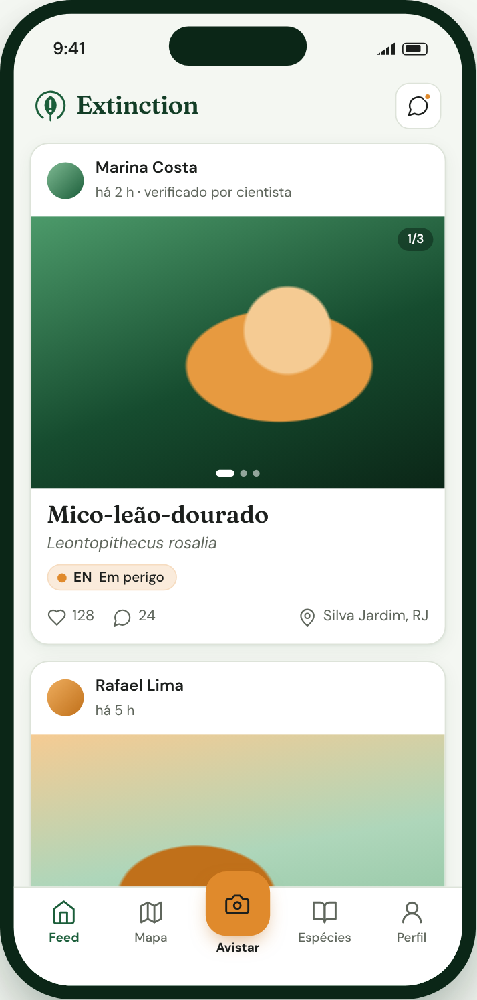
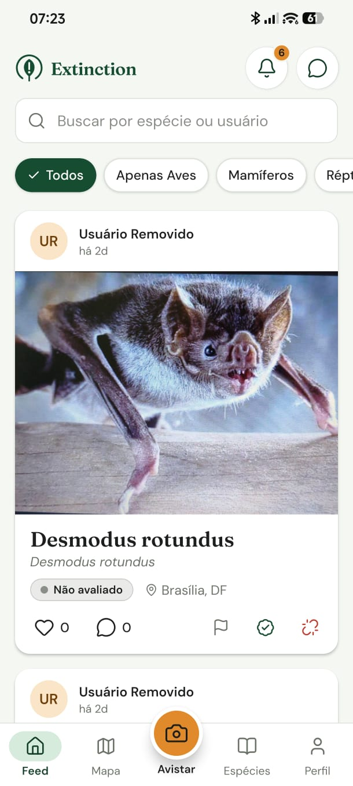
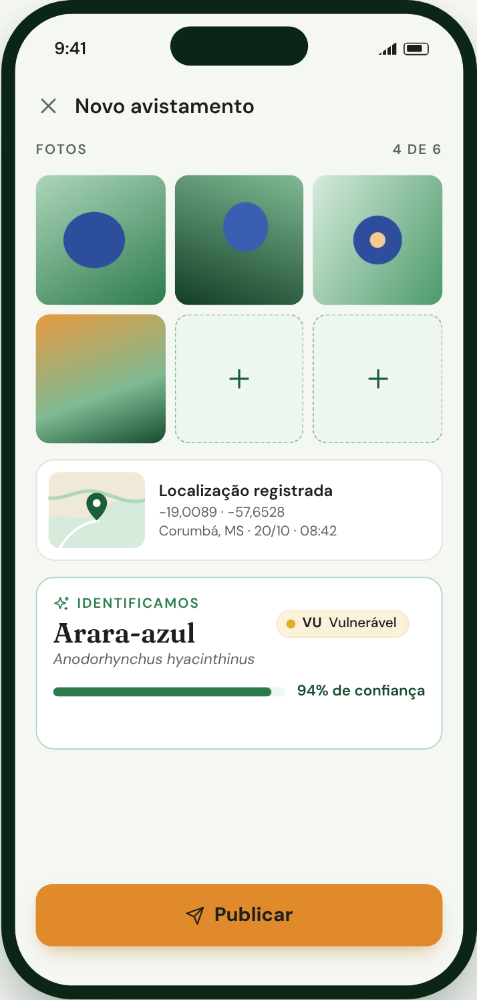
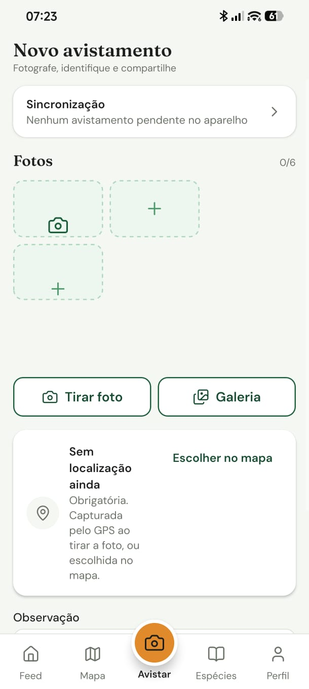
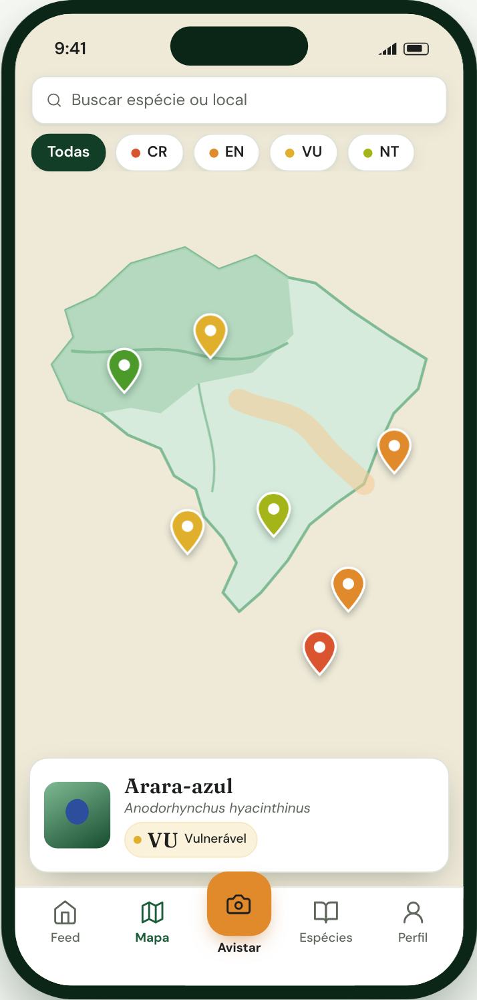
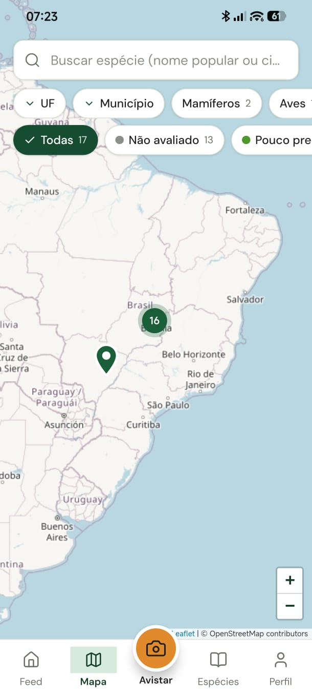

# Design

[Voltar ao início](../README.md)

O protótipo foi construído no Figma Make e serviu de referência para atualizar as telas do app.

## Identidade visual

A direção é a de um guia de campo moderno: fundo claro esverdeado, verde floresta como cor principal e laranja reservado às ações mais importantes.

| Elemento | Definição |
|---|---|
| Títulos | Fraunces |
| Interface | DM Sans |
| Escala de texto | 28, 22, 18, 16, 14 e 12 px |
| Raios | 16 px em cartões e 12 px em botões |
| Ícones | Lucide |

## Decisões de acessibilidade

- O texto sobre o laranja usa tinta escura, porque o branco não atinge contraste suficiente.
- O status de conservação aparece sempre com cor e texto.
- Os pins do mapa usam cor e forma, para que a cor nunca seja a única pista.

## Protótipo

O protótipo tem 18 telas navegáveis, 30 componentes e uma página de Design System.

| Fluxo | Telas |
|---|---|
| Autenticação | Login, cadastro, esqueci a senha e redefinir senha |
| Avistamentos | Feed e novo avistamento |
| Exploração | Mapa, lista de espécies e detalhe da espécie |
| Perfil | Perfil, editar perfil, seguidores, perfil de outro usuário e ranking |
| Conversas | Conversas, chat, novo grupo e editar grupo |

## Do protótipo ao app

| Referência visual | App |
|---|---|
|  |  |
|  |  |
|  |  |

As telas da coluna da esquerda usam dados fictícios. Veja todas as capturas em [Telas do app](telas.md).
