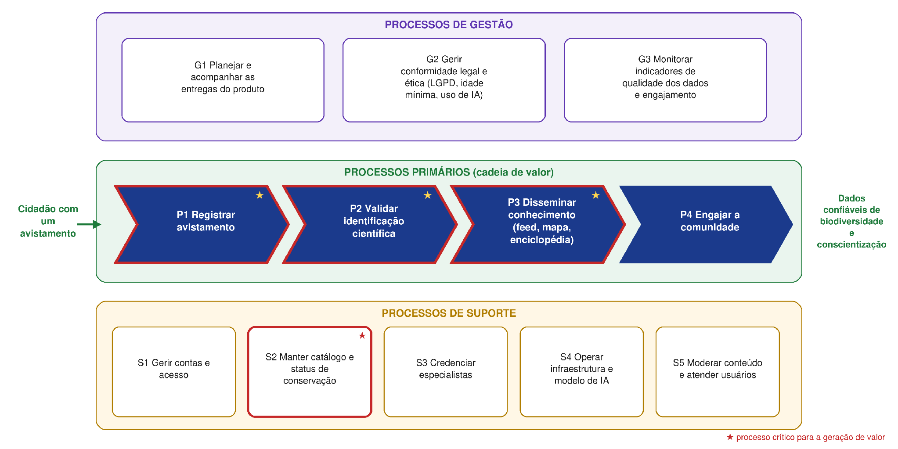
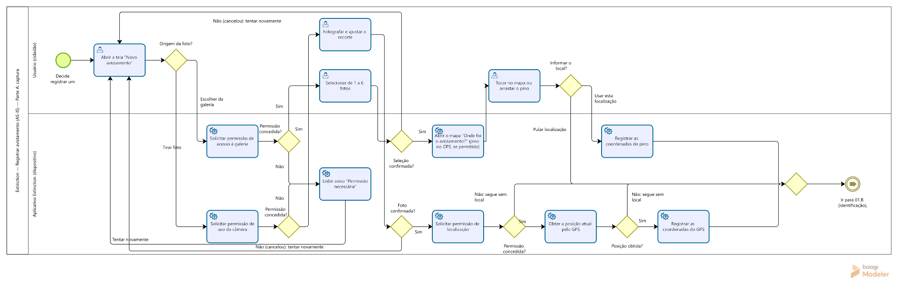
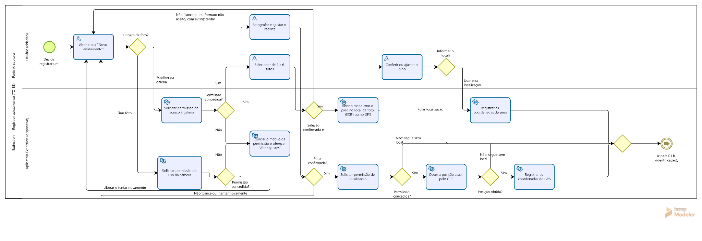
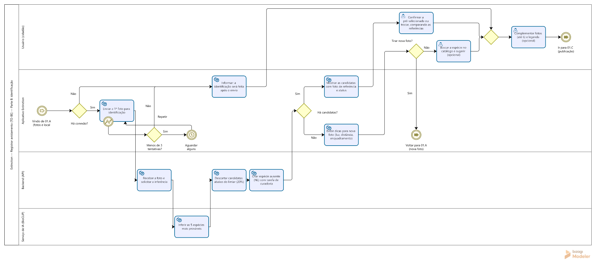
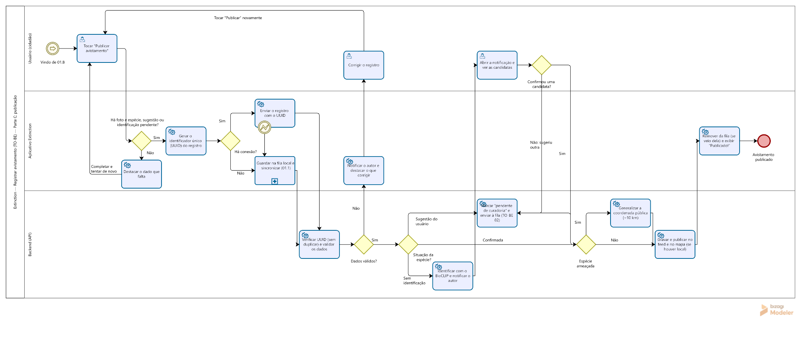
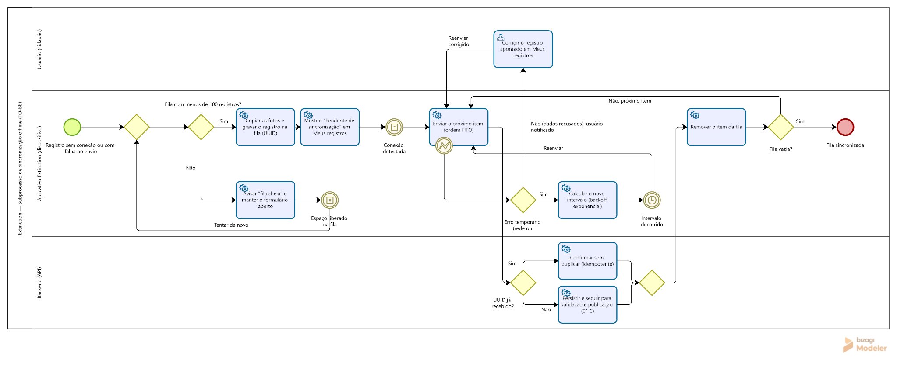
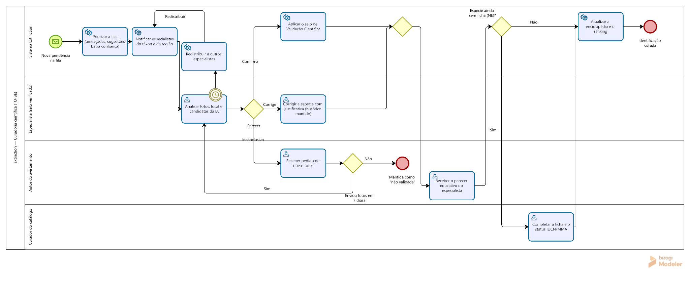

# Processos de negócio

[Voltar ao início](../README.md)

Na disciplina de Processos de Negócio da UCB, o Extinction foi tratado como uma organização. O trabalho mapeou os processos, modelou o estado atual (AS-IS) em BPMN 2.0, analisou gargalos e riscos e propôs um redesenho (TO-BE) centrado nas pessoas.

## Mapa de processos

## Principais problemas encontrados

| Processo | Problema | Impacto |
|---|---|---|
| Registrar avistamento | Dependência de conexão para identificar e publicar | Registros perdidos ou refeitos de memória |
| Registrar avistamento | Coordenada exata de espécies ameaçadas no mapa aberto | Risco ambiental e ético |
| Validar identificação | Especialista encontra erros por acaso no feed | A maioria das postagens não é revisada |
| Validar identificação | Correção exige excluir e republicar | Perda de curtidas, comentários e data original |
| Validar identificação | Curadoria científica feita via SQL pela equipe técnica | Sem trilha de auditoria e uso ineficiente do tempo |

## Exemplo de redesenho

O estado atual da captura de fotos e localização:

O mesmo processo redesenhado, com as mudanças em verde:

## Outros processos redesenhados

### Identificar a espécie

### Publicar o avistamento

### Fila local e sincronização

### Curadoria científica

## Indicadores propostos

| Indicador | Meta |
|---|---|
| Correções que exigem excluir a postagem | 0% |
| Espécies ameaçadas com coordenada exata no mapa público | 0% |
| Usuários novos que concluem o primeiro avistamento em até 3 minutos | Pelo menos 80% |
| Postagens com validação científica | Pelo menos 50% |

## Do processo ao produto

O modo offline e a curadoria científica entraram nos MVPs 0.2 e 1.0. O trabalho também propôs novas regras, como generalizar a localização pública de espécies ameaçadas e priorizar a fila de curadoria.
