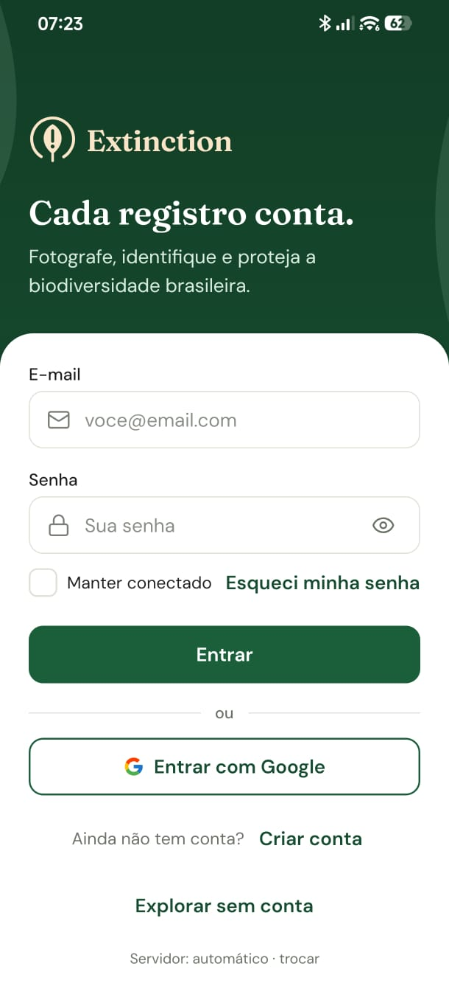
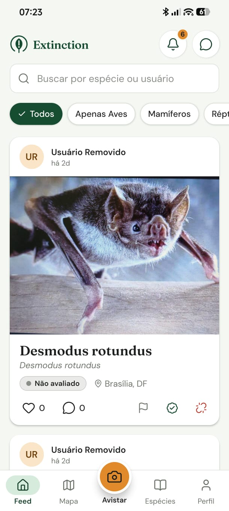
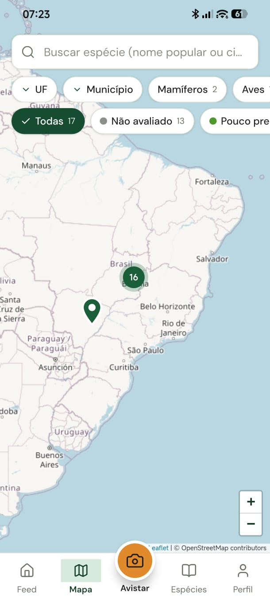
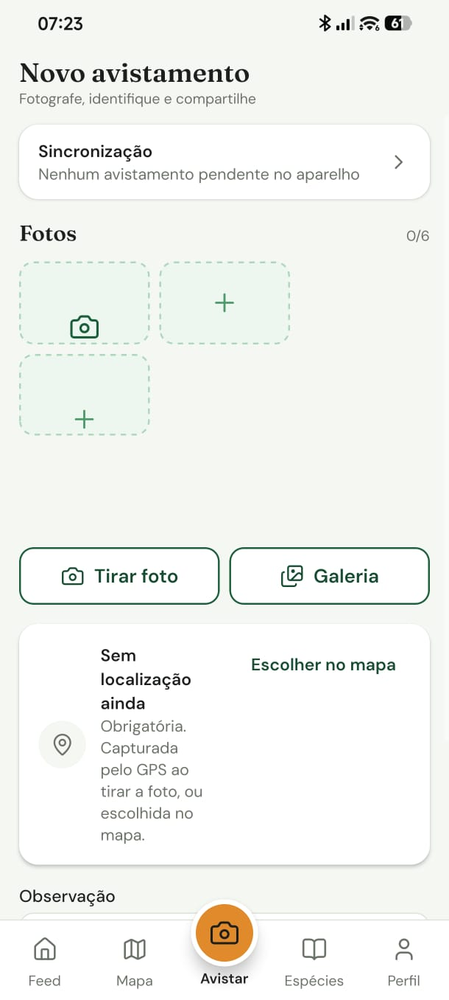
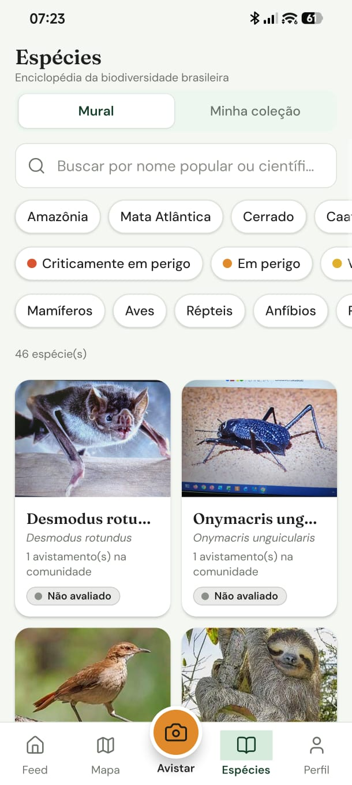
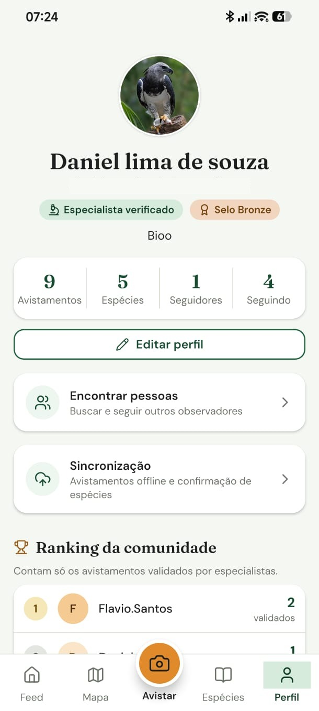

# Telas do app

[Voltar ao início](../README.md)

Capturas do app em execução, conectado ao backend.

<table>
  <tr>
    <td align="center"> <b>Login</b> E-mail e senha, Google e modo de visitante</td>
    <td align="center"> <b>Feed</b> Avistamentos com busca e filtro por classe</td>
    <td align="center"> <b>Mapa</b> Marcadores no OpenStreetMap, com filtros por status, categoria, UF e município</td>
  </tr>
  <tr>
    <td align="center"> <b>Novo avistamento</b> Fotos, localização obrigatória, observação e sincronização</td>
    <td align="center"> <b>Espécies</b> Mural, coleção pessoal, busca e filtros por bioma, risco e classe</td>
    <td align="center"> <b>Perfil</b> Selos, estatísticas, sincronização e ranking da comunidade</td>
  </tr>
</table>
